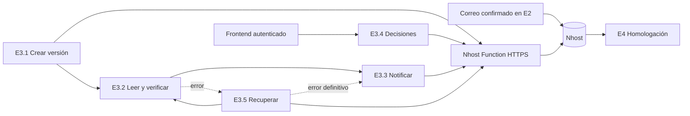

# Etapa 3 — Lectura, estructuración, verificación y decisiones

**Documento:** `etapa-3-reglas-y-flujos.md`
**Estado:** definición funcional previa al desarrollo
**Fecha:** 27 de octubre de 2026

---

## 1. Objetivo

La etapa 3 debe:

1. Recibir los correos confirmados en E2 que contienen una cotización o ficha técnica.
2. Crear una versión documental por cada correo.
3. Recuperar y clasificar sus archivos.
4. Extraer toda la información comercial y técnica.
5. Estructurarla como JSON.
6. Guardarla en Nhost con trazabilidad.
7. Identificar inconsistencias y generar observaciones.
8. Notificar al especialista desde el frontend.
9. Registrar las decisiones del especialista.
10. Entregar a E4 la información estructurada de la versión final.

La IA recupera, interpreta y estructura la información. El especialista decide cuál versión se acepta como final.

---

## 2. Alcance

### Incluye

- Cotizaciones.
- Fichas técnicas.
- Anexos relacionados.
- PDF con texto.
- PDF escaneado.
- Imágenes.
- Excel XLSX/XLS.
- CSV.
- OCR.
- RAG.
- Gemini.
- Verificaciones determinísticas.
- Observaciones.
- Notificaciones dentro de la aplicación.
- Decisiones autenticadas del especialista.
- Recuperación de errores.
- JSON estructurado en Nhost.

### No incluye

- Envío automático de correos al proveedor.
- Homologación de propuestas.
- Generación de un Excel como resultado.
- Selección automática de la versión final.
- Exposición de claves administrativas en el navegador.
- Relectura de documentos por parte de E4.

---

## 3. Estados de los correos provenientes de E2

| Código | Estado visible |
|---|---|
| `respuesta_sin_nueva_cotizacion_ni_ficha_tecnica` | Respuesta sin nueva cotización ni ficha técnica |
| `cotizacion_o_ficha_tecnica_recibida` | Cotización o ficha técnica recibida |
| `cotizacion_o_ficha_tecnica_aceptada_final` | Cotización o ficha técnica aceptada como final |

### Reglas

1. Cada correo tiene un solo estado vigente.
2. n8n puede proponer preliminarmente los dos primeros estados.
3. El usuario confirma o cambia el estado desde el frontend.
4. E3 procesa únicamente correos confirmados como `cotizacion_o_ficha_tecnica_recibida`.
5. Los correos sin documentos permanecen visibles, pero no ingresan a E3.
6. El estado final solamente puede asignarse por decisión del usuario.
7. Un correo posterior sin nueva documentación no reemplaza una versión anterior.
8. Una nueva cotización recibida no reemplaza automáticamente la versión final vigente.

---

## 4. Regla de creación de versiones

Cada correo confirmado como **“Cotización o ficha técnica recibida”** genera una versión.

### Invariantes

- Un `correo_id` genera como máximo un `version_id`.
- Todos los archivos del correo pertenecen a la misma versión.
- Una versión pertenece a una sola solicitud y proveedor.
- El número se asigna de manera atómica dentro de la combinación solicitud-proveedor.
- El número permite identificar la secuencia documental, pero no determina cuál versión es final.
- La fecha del correo se conserva independientemente del número asignado.
- Repetir una ejecución no debe crear otra versión.

### Ejemplo

| Correo | Estado confirmado | Resultado |
|---|---|---|
| Correo 1 | Sin nueva cotización ni ficha técnica | No crea versión |
| Correo 2 | Cotización o ficha técnica recibida | Versión 1 |
| Correo 3 | Sin nueva cotización ni ficha técnica | No crea versión |
| Correo 4 | Cotización o ficha técnica recibida | Versión 2 |

---

## 5. Regla de versión final

El usuario selecciona la versión final desde el frontend.

### Cuando se acepta una versión

1. Se valida la sesión del especialista.
2. Se comprueba que la versión exista y esté procesada.
3. Se comprueba que pertenezca a la solicitud y proveedor correspondientes.
4. Se comprueba que no existan observaciones abiertas que requieran aclaración.
5. El correo seleccionado cambia a `cotizacion_o_ficha_tecnica_aceptada_final`.
6. La versión final anterior del mismo proveedor y solicitud vuelve a `cotizacion_o_ficha_tecnica_recibida`.
7. Se conserva toda la información de la versión anterior.
8. No se ejecutan nuevamente OCR, RAG, Gemini ni la extracción.
9. Se registra el especialista, la fecha y el historial.
10. La operación completa debe ser atómica.

E3 no debe comprobar que la versión elegida sea la documentalmente más reciente. La decisión pertenece al usuario.

### Confirmación del frontend

> Al aceptar esta versión como final, la versión final anterior volverá al estado “Cotización o ficha técnica recibida”. Su información y su historial se conservarán.

### Regla defensiva para E4

Normalmente debe existir una sola versión final activa.

Si E4 encuentra datos históricos inconsistentes con más de una versión final, utilizará la vinculada al correo final más reciente y registrará la inconsistencia.

---

## 6. Estados técnicos del procesamiento

Los estados técnicos no reemplazan los estados del correo.

| Estado técnico | Significado |
|---|---|
| `pendiente` | La versión fue creada y todavía no empezó a procesarse. |
| `procesando` | Se están recuperando o leyendo los documentos. |
| `completado` | La información fue extraída y guardada correctamente. |
| `completado_con_observaciones` | La lectura terminó, pero existen observaciones visibles. |
| `reintento_pendiente` | Ocurrió un error recuperable. |
| `error_procesamiento` | Se agotaron los intentos sin completar la lectura. |

Los estados técnicos deben almacenarse en la versión o en la ejecución de E3, no en `estado_correo`.

---

## 7. Clasificación de los documentos

Cada archivo debe clasificarse como:

| Tipo | Descripción |
|---|---|
| `cotizacion_proveedor` | Contiene precios, cantidades o condiciones comerciales. |
| `ficha_tecnica_proveedor` | Contiene especificaciones o características técnicas. |
| `anexo_proveedor` | Complementa la cotización o ficha técnica. |
| `otro_documento` | Archivo relacionado que no encaja en los anteriores. |

La clasificación no debe depender únicamente de la extensión o el nombre del archivo.

Cada documento debe conservar:

- `documento_id`;
- `correo_id`;
- `version_id`;
- nombre original;
- tipo MIME;
- tipo documental;
- tamaño;
- ubicación en Storage;
- huella SHA-256;
- fecha de recepción;
- estado de lectura.

---

## 8. Procesamiento por formato

| Formato | Ruta |
|---|---|
| PDF con texto | Extracción de texto, división por páginas o secciones, indexación y RAG. |
| PDF escaneado | Conversión a imagen, OCR, división, indexación y RAG. |
| Imagen | OCR, división e indexación cuando corresponda. |
| XLSX/XLS | Lectura directa de todas las hojas, tablas, filas, columnas y celdas. |
| CSV | Lectura directa de todas las filas y columnas. |
| Archivo dañado | Registro del error y recuperación si es posible. |
| Formato no admitido | Observación o error visible según su impacto. |

### PDF con texto

1. Extraer todas las páginas.
2. Conservar el número de página.
3. Dividir el contenido en fragmentos.
4. Crear el índice utilizado por RAG.
5. Consultar el índice por cada criterio del esquema.
6. Comprobar que todas las páginas fueron cubiertas.
7. Enviar la evidencia recuperada a Gemini.

### PDF escaneado o imagen

1. Detectar que no existe texto utilizable.
2. Aplicar OCR.
3. Conservar página, bloque y nivel de confianza.
4. Dividir e indexar el texto obtenido.
5. Aplicar RAG.
6. Enviar el resultado a Gemini.

Aplicar OCR correctamente no constituye una observación.

Solo se genera una observación si el documento es ilegible, está incompleto o la confianza impide interpretar un dato necesario.

### Excel y CSV

1. Leer todas las hojas.
2. Detectar encabezados y tablas.
3. Conservar la posición de cada dato.
4. Leer valores y resultados de fórmulas.
5. Normalizar tipos sin perder el valor original.
6. Enviar la estructura tabular a Gemini.
7. Validar que ninguna hoja relevante quede sin procesar.

Excel y CSV no requieren RAG para la lectura tabular.

---

## 9. Reglas para OCR, RAG y Gemini

### OCR

Debe utilizarse cuando el archivo no contenga texto utilizable.

Debe devolver:

- texto;
- página;
- bloque;
- nivel de confianza;
- ubicación aproximada.

### RAG

RAG se utilizará para:

- localizar criterios específicos;
- relacionar información distribuida;
- recuperar evidencia;
- consultar fichas técnicas extensas;
- reducir el contexto enviado a Gemini.

RAG no reemplaza el control de cobertura completa. Todas las páginas deben registrarse como procesadas o no procesadas.

### Gemini

Gemini debe:

- responder con un esquema JSON fijo;
- no inventar valores;
- utilizar `null` si no encuentra un dato;
- conservar el texto original;
- normalizar unidades en campos separados;
- diferenciar valores explícitos de inferencias;
- indicar la evidencia utilizada;
- identificar contradicciones;
- no combinar versiones diferentes;
- no decidir qué versión es final.

---

## 10. Validaciones determinísticas

Después de Gemini deben ejecutarse reglas de validación independientes.

Como mínimo:

- formato válido del JSON;
- campos obligatorios;
- tipos numéricos;
- moneda;
- cantidades;
- unidades;
- subtotal;
- impuestos;
- total;
- coherencia aritmética;
- plazo de entrega;
- vigencia;
- condiciones de pago;
- consistencia entre cotización y ficha técnica;
- valores contradictorios;
- campos necesarios para E4;
- referencias de evidencia existentes.

Gemini propone la lectura. Las reglas determinísticas verifican que pueda guardarse y utilizarse.

---

## 11. Output estructurado

El único output funcional de E3 es un JSON persistido en Nhost.

No se genera un Excel de salida.

### Contrato general

```json
{
  "version_id": "uuid",
  "correo_id": "uuid",
  "solicitud_id": "uuid",
  "proveedor_id": "uuid",
  "numero_version": 1,
  "es_final": false,
  "estado_procesamiento": "completado",
  "documentos": [],
  "datos_comerciales": {
    "moneda": null,
    "subtotal": null,
    "impuestos": null,
    "total": null,
    "plazo_entrega": null,
    "condiciones_pago": null,
    "vigencia_oferta": null
  },
  "items": [],
  "especificaciones_tecnicas": [],
  "evidencias": [],
  "observaciones": [],
  "procesamiento": {
    "modelo": "gemini",
    "uso_ocr": false,
    "uso_rag": false,
    "procesado_at": null
  }
}
```

El resultado puede almacenarse mediante:

- tablas normalizadas de PostgreSQL;
- relaciones;
- columnas `jsonb`.

Nhost debe devolver a E4 el resultado como JSON mediante GraphQL.

---

## 12. Evidencia y trazabilidad

Cada valor recuperado debe poder rastrearse hasta:

- solicitud;
- proveedor;
- correo;
- versión;
- documento;
- página o sección;
- hoja, fila, columna o celda;
- fragmento utilizado por RAG;
- fecha de extracción.

Ejemplo:

```json
{
  "campo": "capacidad_kg",
  "valor": 750,
  "documento_id": "uuid",
  "pagina": 3,
  "texto_fuente": "Capacidad nominal: 750 kg",
  "confianza": 0.97
}
```

---

## 13. Observaciones

Cada observación debe incluir:

- `observacion_id`;
- `version_id`;
- tipo;
- descripción;
- severidad;
- `requiere_aclaracion`;
- documento y evidencia;
- estado;
- fecha;
- decisión del especialista;
- motivo de descarte, si corresponde.

### Estados de la observación

| Estado | Significado |
|---|---|
| `pendiente` | Todavía requiere revisión. |
| `descartada` | El especialista determinó que no corresponde. |
| `aclaracion_solicitada` | Se registró que se pidió información al proveedor. |

La observación nunca debe eliminarse físicamente.

### Severidad

| Severidad | Uso | Frontend |
|---|---|---|
| Alta | Impide evaluar correctamente | Visible en rojo |
| Media | Puede afectar la comparación | Visible en ámbar |
| Baja | Advertencia técnica menor | Guardada, oculta normalmente |

`requiere_aclaracion` es independiente de `severidad`.

Una observación abierta con `requiere_aclaracion = true` impide aceptar la versión hasta que sea descartada justificadamente o deje de estar pendiente.

---

## 14. Notificaciones

Todas las notificaciones se guardan en Nhost y se muestran en el frontend.

No se envían correos.

### Tipos

| Tipo | Condición | Diseño |
|---|---|---|
| `version_lista_revision` | Lectura terminada sin observaciones visibles | Azul |
| `version_con_observaciones` | Existen observaciones altas o medias | Ámbar |
| `nueva_version_disponible` | Se procesó otra versión documental | Azul o ámbar |
| `error_procesamiento` | Se agotaron los intentos | Rojo o granate |

### Reglas

- Solo notifican los correos con cotización o ficha técnica.
- Los demás correos siguen visibles en la lista.
- No se notifica cada reintento.
- No se notifica el uso correcto de OCR.
- No se notifican observaciones bajas.
- No se notifica la desactivación de una versión final anterior.
- Cada aviso es único por `correo_id`, `version_id` y tipo.
- La notificación debe abrir directamente la versión relacionada.

---

# 15. Flujos de automatización

E3 se divide en **cinco flujos de n8n**.

---

## E3.1 — Recepción y creación de versión

### Activación

Evento de Nhost cuando un correo queda confirmado por el usuario como:

```text
cotizacion_o_ficha_tecnica_recibida
```

### Entrada mínima

```json
{
  "correo_id": "uuid",
  "estado_correo": "cotizacion_o_ficha_tecnica_recibida",
  "origen_estado": "usuario"
}
```

### Precondiciones

- El correo existe.
- Pertenece a una solicitud y proveedor.
- El estado fue confirmado por el usuario.
- Existe acceso a su mensaje y adjuntos.
- No existe otra versión para el mismo `correo_id`.

### Proceso

1. Consumir la operación interna de Nhost mediante la Function HTTPS protegida.
2. Consultar el correo en Nhost.
3. Validar su estado.
4. Buscar una versión existente.
5. Si ya existe, terminar sin reprocesar.
6. Recuperar exactamente sus adjuntos.
7. Calcular SHA-256.
8. Evitar archivos duplicados.
9. Clasificar los documentos.
10. Crear el siguiente número de versión atómicamente.
11. Vincular correo, versión y documentos.
12. Marcar la versión como `pendiente`.
13. invocar E3.2.

### Salida

```json
{
  "resultado": "version_creada",
  "correo_id": "uuid",
  "version_id": "uuid",
  "numero_version": 2,
  "documentos": []
}
```

### Idempotencia

Si la versión ya existe, debe devolver:

```json
{
  "resultado": "version_existente",
  "correo_id": "uuid",
  "version_id": "uuid"
}
```

No debe crear documentos, notificaciones ni versiones adicionales.

---

## E3.2 — Lectura, estructuración y verificación

### Activación

Versión creada por E3.1 o reintento autorizado por E3.5.

### Entrada mínima

```json
{
  "version_id": "uuid",
  "correo_id": "uuid"
}
```

### Proceso

1. Consultar versión y documentos.
2. Cambiar el estado a `procesando`.
3. Determinar el formato de cada archivo.
4. Aplicar lectura directa, OCR o RAG.
5. Crear el contexto para Gemini.
6. Solicitar el JSON estructurado.
7. Validar el esquema.
8. Ejecutar verificaciones determinísticas.
9. Guardar datos, ítems, especificaciones y evidencias.
10. Crear observaciones.
11. Actualizar el estado:
    - `completado`; o
    - `completado_con_observaciones`.
12. Enviar el resultado a E3.3.

### Salida

```json
{
  "resultado": "procesamiento_completado",
  "version_id": "uuid",
  "estado_procesamiento": "completado_con_observaciones",
  "observaciones_altas": 1,
  "observaciones_medias": 2
}
```

### Consideraciones

- No mezclar documentos de otros correos.
- No procesar nuevamente una versión completada.
- No guardar respuestas parciales como completadas.
- El guardado estructurado debe ser transaccional.
- Una ejecución fallida debe pasar a E3.5.

---

## E3.3 — Notificaciones del frontend

### Activación

Resultado de E3.2 o error definitivo de E3.5.

### Entrada

```json
{
  "tipo": "version_con_observaciones",
  "correo_id": "uuid",
  "version_id": "uuid",
  "datos": {}
}
```

### Proceso

1. Validar que el correo contenga documentación.
2. Crear título y mensaje.
3. Definir color e icono.
4. Calcular una clave de deduplicación.
5. Comprobar si ya existe.
6. Guardar la notificación en Nhost.

### Salida

```json
{
  "resultado": "notificacion_registrada",
  "notificacion_id": "uuid"
}
```

### Restricciones

- No usar Gmail.
- No enviar mensajes al proveedor.
- No generar duplicados.
- No generar avisos para correos sin documentación.

---

## E3.4 — Decisiones del especialista

### Activación

`POST` autenticado desde el frontend.

El usuario se obtiene de la sesión de Nhost. No debe recibirse como un identificador libre y confiable dentro del JSON.

### Acción: aceptar versión

```json
{
  "accion": "aceptar_version",
  "version_id": "uuid"
}
```

#### Proceso

1. Validar sesión y rol.
2. Consultar la versión.
3. Confirmar que terminó de procesarse.
4. Revisar observaciones que requieran aclaración.
5. Pedir confirmación en el frontend.
6. Cambiar el correo seleccionado a final.
7. Devolver la versión final anterior a “recibida”.
8. No volver a procesar la anterior.
9. Registrar la acción y el historial.
10. Devolver el resultado real.

### Acción: descartar observación

```json
{
  "accion": "descartar_observacion",
  "observacion_id": "uuid",
  "motivo": "La diferencia fue verificada en la ficha técnica."
}
```

#### Reglas

- El motivo es obligatorio.
- La observación se conserva.
- Se registra quién la descartó.
- Una observación descartada deja de bloquear la aceptación.

### Acción: registrar aclaración solicitada

```json
{
  "accion": "solicitar_aclaracion",
  "version_id": "uuid",
  "motivo": "Confirmar la capacidad nominal.",
  "medio": "correo"
}
```

#### Medios permitidos

- correo;
- llamada;
- WhatsApp;
- reunión;
- otro.

#### Reglas

- Motivo y medio son obligatorios.
- La acción solo registra la gestión.
- No envía un mensaje al proveedor.
- Se conserva fecha, especialista y versión.

### Respuesta general

```json
{
  "ok": true,
  "accion": "aceptar_version",
  "mensaje": "La versión fue aceptada como final.",
  "version_id": "uuid"
}
```

Los rechazos deben devolver un código y un motivo comprensible.

---

## E3.5 — Recuperación de errores

### Activación

- Error recibido desde E3.1 o E3.2.
- Ejecución estancada.
- Solicitud manual de reintento desde el frontend.

### Proceso

1. Registrar la ejecución fallida.
2. Clasificar el error como recuperable o definitivo.
3. Consultar el número de intentos.
4. Reintentar desde un punto seguro.
5. Realizar como máximo tres intentos totales.
6. Evitar duplicar versiones, datos y notificaciones.
7. Si se recupera, regresar a E3.2.
8. Si no se recupera:
   - marcar `error_procesamiento`;
   - guardar el detalle técnico;
   - solicitar una notificación a E3.3.

### Información para el usuario

> No fue posible procesar el archivo después de tres intentos.

Acciones:

- Reintentar;
- Ver archivo.

Los detalles técnicos quedan en los registros de n8n y Nhost.

Las operaciones transaccionales de E3.5 también se invocan por la Function HTTPS
protegida. La Function acepta solamente operaciones E3 declaradas y ejecuta
`public.e3_operar` dentro del proyecto Nhost. n8n no usa credenciales PostgreSQL.

---

## 16. Arquitectura



---

## 17. Datos mínimos en Nhost

La implementación debe contemplar entidades equivalentes a:

- correos del proveedor;
- historial de estados del correo;
- versiones;
- documentos;
- ejecuciones de lectura;
- resultado JSON estructurado;
- ítems de cotización;
- especificaciones técnicas;
- evidencias;
- observaciones;
- aclaraciones registradas;
- notificaciones;
- decisiones del especialista;
- intentos y errores.

Los nombres definitivos de tablas deben verificarse contra el esquema existente antes de crear migraciones.

---

## 18. Requisitos del frontend

El frontend debe:

1. Mostrar todos los correos y sus estados.
2. Mostrar las versiones documentales.
3. Abrir una versión específica.
4. Mostrar sus archivos.
5. Mostrar los datos estructurados.
6. Mostrar observaciones altas y medias.
7. Ocultar normalmente las observaciones bajas.
8. Mostrar evidencia y ubicación.
9. Confirmar antes de aceptar una versión.
10. Exigir motivo al descartar.
11. Exigir motivo y medio al registrar una aclaración.
12. Bloquear el botón mientras n8n procesa.
13. Mostrar el resultado real de n8n.
14. Actualizar la pantalla después de cada acción.
15. Mostrar notificaciones azules, ámbar y rojas según su tipo.
16. Permitir reintentar un error definitivo.
17. No contener claves administrativas.

---

## 19. Seguridad

1. El frontend utiliza el JWT de Nhost.
2. n8n valida la sesión.
3. El especialista se identifica mediante la sesión.
4. `HASURA_GRAPHQL_ADMIN_SECRET` nunca se expone al navegador.
5. Las credenciales administrativas permanecen en n8n.
6. Cada acción valida acceso a la solicitud afectada.
7. Todas las decisiones se auditan.
8. Las operaciones críticas se ejecutan de forma atómica.
9. Las solicitudes repetidas deben ser idempotentes.

---

## 20. Contrato con E4

E4 consultará mediante GraphQL el JSON de la versión final activa.

E4 no volverá a leer los archivos originales.

La información entregada incluirá:

- proveedor;
- versión;
- datos comerciales;
- ítems;
- precios;
- cantidades;
- monedas;
- unidades;
- condiciones;
- especificaciones técnicas;
- evidencias;
- observaciones;
- decisiones;
- trazabilidad.

Si un proveedor no tiene una versión final, su propuesta no está disponible para homologación.

---

## 21. Funciones existentes que se mantienen

Se conservan:

- Guardar corrección;
- Guardar coordinación;
- Marcar como atendida.

Estas funciones no sustituyen:

- aceptar una versión;
- descartar una observación;
- registrar una aclaración.

---

## 22. Cambios necesarios en el flujo actual

El flujo existente debe modificarse para:

1. Reemplazar la búsqueda general en Gmail por eventos basados en `correo_id`.
2. Procesar únicamente correos confirmados desde E2.
3. Dividir el flujo monolítico en cinco flujos.
4. Vincular todas las entidades con `correo_id` y `version_id`.
5. Clasificar cotizaciones, fichas técnicas y anexos.
6. Procesar todos los formatos admitidos.
7. Incorporar OCR.
8. Incorporar RAG.
9. Reemplazar Qwen por Gemini.
10. Eliminar bloques de código duplicados.
11. Aplicar un esquema JSON fijo.
12. Agregar validaciones determinísticas.
13. Guardar el resultado estructurado en Nhost.
14. Eliminar la exportación a Excel.
15. Eliminar las notificaciones por Gmail.
16. Mantener las decisiones en un flujo separado y autenticado.
17. Agregar reintentos, auditoría e idempotencia.
18. Impedir que la desactivación de una versión final vuelva a disparar su lectura.

---

## 23. Casos mínimos de validación

Antes de considerar E3 terminada deben validarse estos casos:

1. Un correo sin documentos no genera versión.
2. Un correo documental genera una sola versión.
3. Repetir E3.1 no duplica la versión.
4. Dos archivos del mismo correo pertenecen a la misma versión.
5. Un PDF con texto se procesa con trazabilidad.
6. Un PDF escaneado utiliza OCR y RAG.
7. Un Excel procesa todas sus hojas.
8. Gemini devuelve JSON válido.
9. Los valores guardan evidencia.
10. Las observaciones altas y medias aparecen en el frontend.
11. Las bajas permanecen ocultas.
12. Una observación pendiente que requiere aclaración bloquea la aceptación.
13. Descartarla exige un motivo.
14. Registrar una aclaración no envía correo.
15. Aceptar una nueva versión desactiva la final anterior.
16. La versión anterior no se vuelve a procesar.
17. Un error recuperable se reintenta.
18. Un error definitivo genera una notificación roja.
19. No se envían notificaciones por correo.
20. El navegador no recibe secretos administrativos.
21. E4 obtiene mediante GraphQL el JSON de la versión final.

---

## 24. Configuraciones técnicas que deben definirse antes del desarrollo

Las reglas funcionales están cerradas. Aún deben elegirse estas configuraciones técnicas:

- modelo exacto de Gemini;
- servicio o método de OCR;
- modelo de embeddings;
- almacenamiento del índice RAG;
- tamaño de los fragmentos;
- formatos y tamaños máximos;
- tiempos entre reintentos;
- límites de contexto;
- esquema JSON detallado según la plantilla de homologación;
- política de retención de archivos y ejecuciones.

Estas decisiones no cambian las reglas de negocio, pero deben definirse antes de configurar los nodos definitivos de n8n.
